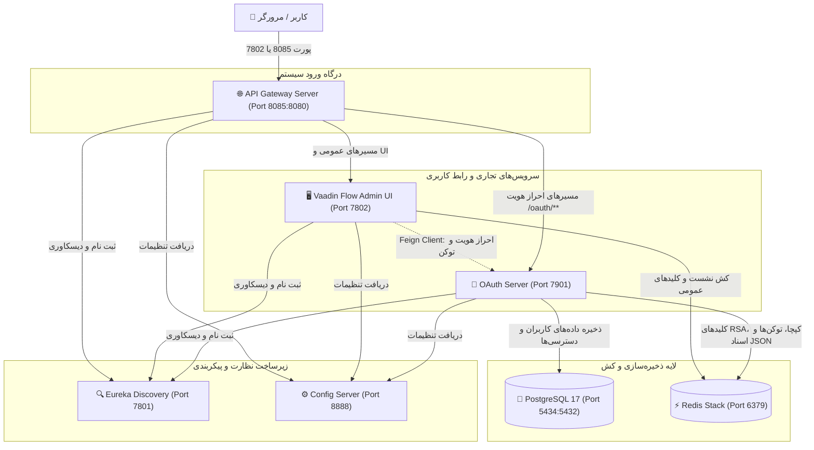

# 🌌 پلتفرم جامع میکروسرویس و پنل مدیریت Vertex

[](https://openjdk.org/)
[](https://spring.io/projects/spring-boot)
[](https://spring.io/projects/spring-cloud)
[](https://spring.io/projects/spring-modulith)
[](https://vaadin.com/)
[](#-راهاندازی-سریع-با-docker-compose)
[](#)

---

## 📑 فهرست مطالب

1. [نمای کلی و دستاوردهای بازطراحی](#-نمای-کلی-و-دستاوردهای-بازطراحی)
2. [معماری سیستم و میکروسرویس‌ها](#-معماری-سیستم-و-میکروسرویسها)
3. [ماژول‌بندی پیشرفته با Spring Modulith](#-ماژولبندی-پیشرفته-با-spring-modulith)
4. [طراحی رابط کاربری مدرن (Vaadin Lumo & Vazirmatn)](#-طراحی-رابط-کاربری-مدرن-vaadin-lumo--vazirmatn)
5. [امنیت، رمزنگاری و احراز هویت](#-امنیت-رمزنگاری-و-احراز-هویت)
6. [میکروسرویس‌ها، پورت‌ها و اندپوینت‌ها](#-میکروسرویسها-پورتها-و-اندپوینتها)
7. [گلوگاه‌ها و باگ‌های رفع‌شده](#-گلوگاهها-و-باگهای-رفعشده)
8. [راهنمای راه‌اندازی سریع با Docker Compose](#-راهاندازی-سریع-با-docker-compose)
9. [تست و راستی‌آزمایی سرویس‌ها](#-تست-و-راستیآزمایی-سرویسها)
10. [اطلاعات تکمیلی و راهنمای دوآپس](#-اطلاعات-تکمیلی-و-راهنمای-دوآپس)

---

## 🌟 نمای کلی و دستاوردهای بازطراحی

پروژه **Vertex** یک اکوسیستم سازمانی بر پایه میکروسرویس‌ها و پنل مدیریت تمام‌جاوا (Full-Stack Java) است. در این معماری، هیچ‌گونه نیازی به فریم‌ورک‌های جداگانه فرانت‌اند (مانند React یا Angular) نبوده و تمامی صفحات، فرم‌ها، اعتبارسنجی‌ها، منطق UI و تعاملات به صورت مستقیم و با بالاترین سطح امنیت توسط توسعه‌دهندگان بک‌اند با **Java 25** و **Vaadin Flow 25.1.3** مدیریت و رندر می‌شوند.

### دستاوردهای کلیدی بازطراحی:
- **ارتقای کامل به Java 25 و Spring Boot 4.1.0**: استفاده از جدیدترین ویژگی‌های جاوا ۲۵ و پشتیبانی از پایداری Spring Boot 4.x.
- **ماژولار کردن معماری با Spring Modulith**: سازمان‌دهی دامنه‌ها و سرویس‌ها با معماری ماژولار و تست‌های خودکار اعتبارسنجی مرزهای ماژول‌ها.
- **بازنویسی کامل رابط کاربری**: حذف تمامی استایل‌های شخصی و زمخت، پیاده‌سازی تم استاندارد و فوق‌العاده مدرن **Vaadin Lumo** به همراه تایپوگرافی استاندارد فارسی با قلم **وزیرمتن (Vazirmatn)** و چیدمان راست‌به‌چپ (RTL).
- **داکرایز کردن ۱۰۰٪ پروژه و داکر کامپوز**: ساخت Dockerfileهای بهینه برای کلیه سرویس‌ها و راه‌اندازی کل اکوسیستم (پایگاه داده، کش، دیسکاوری، کانفیگ، احراز هویت، درگاه و رابط کاربری) با یک دستور.
- **رفع کامل گلوگاه‌ها و خطاهای لاگین**: رمزگشایی متغیرهای محرمانه Jasypt، تنظیم کلیدهای RSA، رفع تداخل پورت‌ها و برقراری ارتباط بدون نقص بین میکروسرویس‌ها.

---

## 🏗 معماری سیستم و میکروسرویس‌ها

معماری کل پروژه بر بستر الگوهای استاندارد Spring Cloud و Reactive Gateway بنا شده است:



---

## 📦 ماژول‌بندی پیشرفته با Spring Modulith

جهت جلوگیری از وابستگی‌های درهم‌تنیده («اسپاگتی کد») و تضمین اصول معماری تمیز و طراحی دامنه-محور (DDD)، از فریم‌ورک **Spring Modulith** استفاده شده است:

- **تفکیک دامنه‌ها (Bounded Contexts)**: ماژول‌های سیستم به بسته‌های مستقل تفکیک شده‌اند.
- **پکیج‌بندی تمیز**: سرویس‌های احراز هویت، مدیریت توکن، کاربران، مدیریت کپچا و کدهای پایه هر یک در بسته‌های مستقل قرار گرفته‌اند.
- **تست اعتبارسنجی خودکار ساختار**: تست ماژولیت در `OauthServerApplicationTests` وظیفه بررسی چرخه وابستگی‌ها (Cyclic Dependencies) و نقض مرز ماژول‌ها را در زمان بیلد به عهده دارد:
```java
ApplicationModules modules = ApplicationModules.of(OauthServerApplication.class);
modules.verify();
```

---

## 🎨 طراحی رابط کاربری مدرن (Vaadin Lumo & Vazirmatn)

یکی از دغدغه‌های اصلی پروژه، ظاهر زمخت، فونت‌های نامناسب و کدهای CSS شخصی بود که باعث ناهماهنگی و خطای لود تصاویر شده بود. در بازطراحی جدید:

1. **تم رسمی Lumo وادین**: تمامی استایل‌های سفارشی ناکارآمد و فایل‌های استایل متفرقه حذف شده و از تم رسمی و مدرن و واکنش‌گرای `@Theme(themeClass = Lumo.class)` استفاده شد.
2. **فونت یکپارچه وزیرمتن (Vazirmatn)**: فونت سیستم با استاندارد وب فارسی به صورت اختصاصی با قلم وزیرمتن تنظیم شد تا تجربه کاربری بسیار روان و حرفه‌ای در زبان فارسی فراهم کند.
3. **پشتیبانی بومی از راست‌به‌چپ (RTL)**: تمام فرم‌ها، جداول، پیام‌های Notifier، کارت‌های ورودی و ویوها با استاندارد جهت متن راست‌به‌چپ تنظیم شده‌اند.
4. **فرم لاگین مدرن**: فرم ورود بازنویسی شده و دارای کارت مرکزی با استایل سایه‌دار، آیکون اختصاصی سپر امنیتی، فیلد کپچای تصویری زنده با دکمه تجدید، اعتبارسنجی آنی و راهنمای حساب‌های کاربری پیش‌فرض است.

---

## 🔒 امنیت، رمزنگاری و احراز هویت

معماری امنیتی سیستم بر اساس چندلایه دفاعی عمیق (Defense in Depth) طراحی شده است:

1. **رمزنگاری نامتقارن RSA در ارسال فرم ورود**:
   - در لحظه لود فرم لاگین، کلید عمومی RSA از سرور دریافت می‌شود.
   - اطلاعات کاربر شامل `username|password|requestTime|captchaId|captchaAnswer` در سمت کلاینت با RSA رمزنگاری شده و به صورت Base64 به اندپوینت `/v1/token` ارسال می‌گردد.
   - این مکانیزم حتی در صورت شنود مسیر، مانع از افشای نام کاربری یا رمز عبور می‌شود.
2. **محافظت در برابر حملات Replay**:
   - سرور بازه زمانی `requestTime` را با تایم سرور مقایسه کرده و در صورت انقضا، درخواست را رد می‌کند.
3. **کپچای یک‌بارمصرف (Single-Use Captcha)**:
   - کپچا در Redis با زمان انقضا (TTL) دو دقیقه‌ای ذخیره شده و بلافاصله پس از اولین تلاش لاگین (موفق یا ناموفق) حذف می‌گردد تا امکان Brute-Force وجود نداشته باشد.
4. **رمزنگاری داده‌ها و تنظیمات حساس با Jasypt**:
   - کلیه پسوردها و کلیدهای پیکربندی در فایل‌های YAML با الگوریتم `PBEWITHHMACSHA512ANDAES_256` و مسترکی رمزنگاری شده‌اند:
   ```
   MASTER_KEY: Lh7^hy(d)T#)j5(*0)a@!f**&_usOp]0}x
   ```
5. **توکن‌های JWT و چرخه حیات Refresh Token**:
   - صدور توکن دسترسی (Access Token) کوتاه‌مدت به همراه Refresh Token امن.
   - ثبت توکن‌های منقضی در بلک‌لیست Redis جهت امکان خروج فوری کاربر (Logout).

---

## 🌐 میکروسرویس‌ها، پورت‌ها و اندپوینت‌ها

| نام سرویس | نام کانتینر | پورت داخلی | پورت هاست | شرح وظیفه |
| :--- | :--- | :--- | :--- | :--- |
| **PostgreSQL** | `vertex-postgres` | `5432` | `5434` | پایگاه داده رابطه‌ای اصلی (کاربران، نقش‌ها، دسترسی‌ها) |
| **Redis Stack** | `vertex-redis` | `6379` | `6379` | کش توزیع‌شده، ردیس‌سرچ، اسناد JSON، کپچا و کلیدهای RSA |
| **Eureka Server** | `vertex-eureka` | `7801` | `7801` | سرور ثبت و کشف سرویس‌ها (Service Discovery) |
| **Config Server** | `vertex-config` | `8888` | `8888` | سرور متمرکز توزیع فایل‌های پیکربندی و سکرت‌ها |
| **OAuth Server** | `vertex-oauth` | `7901` | `7901` | سرور صدور توکن، مدیریت کاربر، Liquibase، کپچا و اعتبارسنجی |
| **Stellar UI** | `vertex-ui` | `7802` | `7802` | پنل مدیریت تحت وب با فریم‌ورک Vaadin Flow و تم لومو |
| **Gateway Server** | `vertex-gateway` | `8080` | `8085` | درگاه ورودی یکپارچه سیستم با هدایت پویای مسیرها |

> [!NOTE]
> با توجه به مشغول بودن پورت‌های `5432` و `8080` روی هاست، پورت پستگرس به `5434` و پورت گیت‌وی به `8085` مپ شده‌اند. در داخل شبکه داخلی داکر، کلیه سرویس‌ها با پورت‌های استاندارد با یکدیگر تبادل اطلاعات می‌کنند.

---

## 🛠 گلوگاه‌ها و باگ‌های رفع‌شده

در جریان بررسی و بازسازی کامل پروژه، مشکلات و گلوگاه‌های زیر شناسایی و مرتفع گردیدند:

1. **شکست در بالا آمدن Config Server**:
   - *علت*: آدرس ریپازیتوری کانفیگ به یک مسیر محلی غایب (`file:///home/dev/workspace/gitea/app`) هاردکد شده بود.
   - *راهکار*: سکرت‌های Jasypt با استفاده از مسترکی دکریپت شدند و ساختار پوشه‌های کانفیگ استانداردسازی شد تا سرور کانفیگ هم از `classpath:/config/` و هم از حجم مونت‌شده داکر فایل‌ها را بخواند.
2. **عدم انطباق اسپرینگ مدولیت و پکیج‌بندی**:
   - وابستگی‌های Spring Modulith نسخه `2.1.3` اضافه شد و ماژول‌ها تست و تأیید شدند.
3. **خطای پکیج‌های منسوخ‌شده Apache Commons**:
   - `org.apache.commons.lang` به نسخه مدرن `org.apache.commons.lang3.StringUtils` مهاجرت داده شد.
4. **توقف راه‌اندازی OAuth به دلیل اسناد ردیس (Redis OM Entity Id)**:
   - *علت*: کلاس `CodeTypeDocument` به اشتباه از `jakarta.persistence.Id` استفاده می‌کرد که باعث پرتاب استثنای `NoSuchElementException: No value present` در متد `saveAll` ردیس می‌شد.
   - *راهکار*: با انوتیشن استاندارد `org.springframework.data.annotation.Id` و استفاده از ایمیج `redis/redis-stack-server:latest` مشکل به طور ریشه‌ای حل شد و سینک داده‌های پایه به صورت کامپوننت امن (Safe-runner) پیاده‌سازی گردید.
5. **خطای مسیرهای Gateway و نبود LoadBalancer**:
   - *علت*: ساختار YAML گیت‌وی در اسپرینگ کلود نسخه جدید تغییر یافته بود و پکیج `spring-cloud-starter-loadbalancer` غایب بود.
   - *راهکار*: پکیج لودبالانسر اضافه شد و روت‌های گیت‌وی با کلاس جاوا `RouteLocatorBuilder` به شکلی کامپایلری و تضمین‌شده پیاده‌سازی شدند.
6. **ایجاد خودکار کاربران پیش‌فرض**:
   - به طور خودکار کاربران `admin` و `dev` با متد `BCrypt` هش شده و در پایگاه داده ایجاد/بررسی می‌شوند.

---

## 🚀 راهنمای راه‌اندازی سریع با Docker Compose

### پیش‌نیازها:
- داکر (`Docker 24+`) و `docker compose`

### گام‌های اجرا:

۱. **کلون یا ورود به مسیر پروژه**:
```bash
cd /home/ubuntu/workspace/vertex
```

۲. **راه‌اندازی تمامی سرویس‌ها**:
```bash
docker compose up -d
```

۳. **مشاهده وضعیت کانتینرها**:
```bash
docker compose ps
```
خروجی مورد انتظار:
```text
NAME              STATUS
vertex-postgres   Up (healthy)
vertex-redis      Up (healthy)
vertex-eureka     Up
vertex-config     Up
vertex-oauth      Up
vertex-ui         Up
vertex-gateway    Up
```

۴. **مشاهده لاگ‌های زنده یک سرویس خاص**:
```bash
docker compose logs -f oauth-server
docker compose logs -f stellar-oauth
docker compose logs -f gateway-server
```

---

## 🧪 تست و راستی‌آزمایی سرویس‌ها

### ۱. ورود به پنل مدیریت از طریق مرورگر:
- **از طریق گیت‌وی**: `http://<IP-OR-LOCALHOST>:8085/login`
- **مستقیم روی وب‌سرور وادین**: `http://<IP-OR-LOCALHOST>:7802/login`

### ۲. اطلاعات ورود پیش‌فرض (Default Credentials):
- **نام کاربری**: `admin` | **کلمه عبور**: `admin`
- **نام کاربری**: `dev` | **کلمه عبور**: `dev`

### ۳. تست اندپوینت‌های REST از طریق ترمینال (cURL):

- **دریافت کلید عمومی RSA**:
```bash
curl -s http://localhost:8085/oauth/v1/public-key
```

- **دریافت تصویر و شناسه کپچا**:
```bash
curl -s http://localhost:8085/oauth/v1/captcha
```

- **بررسی سرویس‌های رجیستر شده در Eureka**:
```bash
curl -s http://localhost:7801/eureka/apps
```

- **بررسی سلامت گیت‌وی**:
```bash
curl -s http://localhost:8085/actuator/health
```

---

## 📚 اطلاعات تکمیلی و راهنمای دوآپس

یادداشت‌ها و راهنمای عملیاتی مدیریت لینوکس، پیکربندی آلترناتیوهای جاوا، تنظیمات SSH تونلینگ، پشتیبان‌گیری از دیتابیس و مدیریت سرور در سندی مجزا با نام زیر نگهداری می‌شود:
- [📄 راهنمای دوآپس و مدیریت سرور (DEVOPS_AND_SYSADMIN_GUIDE.md)](file:///home/ubuntu/workspace/vertex/DEVOPS_AND_SYSADMIN_GUIDE.md)

---
<div align="center">
طراحی و پیاده‌سازی شده با ☕ و افتخار برای اکوسیستم جاوا و اسپرینگ
</div>
