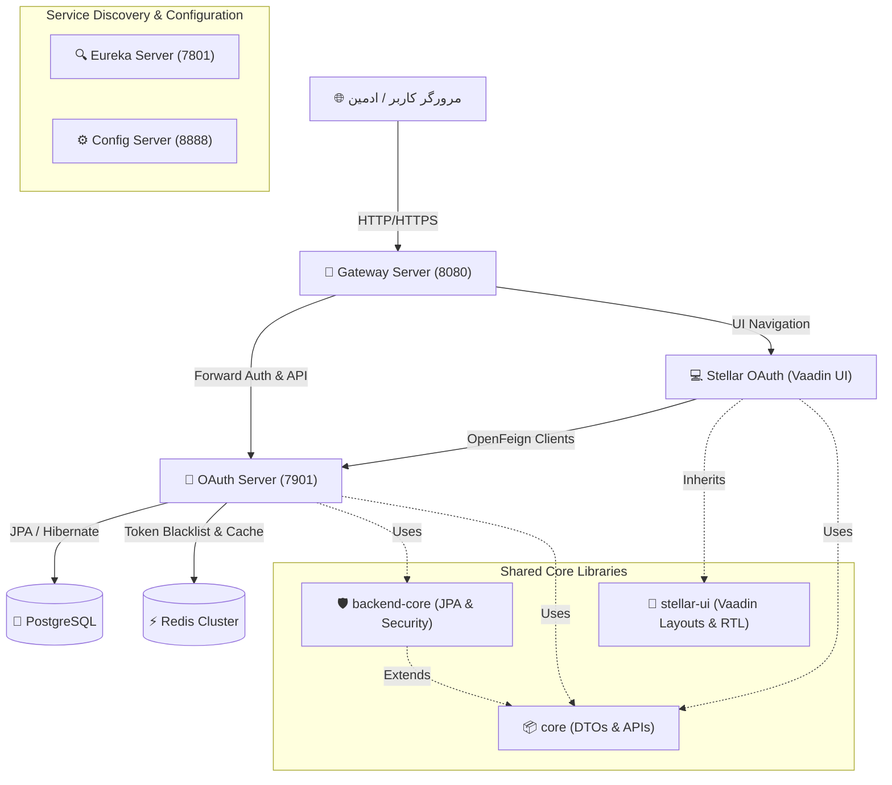
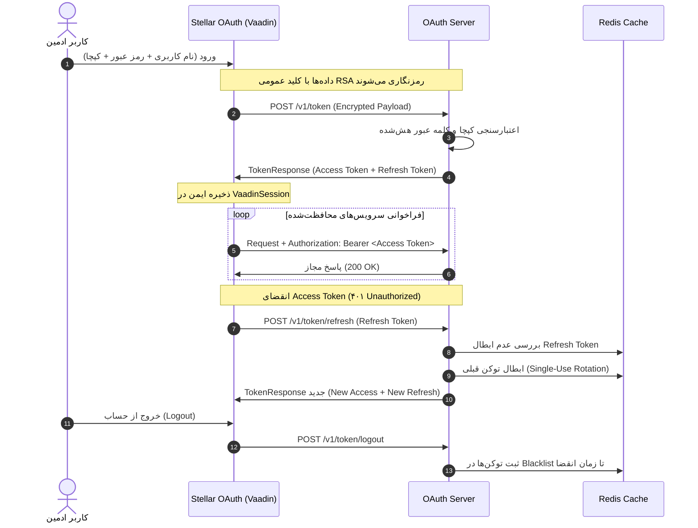

# 🌌 Vertex Platform — اکوسیستم جامع میکروسرویس و پنل مدیریت وادین

[](https://openjdk.org/)
[](https://spring.io/projects/spring-boot)
[](https://spring.io/projects/spring-cloud)
[](https://vaadin.com/)
[](#معماری-سیستم)
[](#امنیت-و-چرخه-حیات-توکن)

---

## 📖 فهرست مطالب

1. [نمای کلی پروژه](#-نمای-کلی-پروژه)
2. [معماری سیستم و میکروسرویس‌ها](#-معماری-سیستم-و-میکروسرویسها)
3. [ماژول‌ها و وظایف هر سرویس](#-ماژولها-و-وظایف-هر-سرویس)
4. [صفحات پیاده‌سازی شده پنل مدیریت](#-صفحات-پیادهسازی-شده-پنل-مدیریت)
5. [امنیت و چرخه حیات توکن‌ها](#-امنیت-و-چرخه-حیات-توکنها)
6. [طراحی رابط کاربری و تجربه کاربری (UI/UX)](#-طراحی-رابط-کاربری-و-تجربه-کاربری-uiux)
7. [راهنمای راه‌اندازی و اجرا](#-راهنمای-راهاندازی-و-اجرا)
8. [مستندات تکمیلی و DevOps](#-مستندات-تکمیلی-و-devops)

---

## 🌟 نمای کلی پروژه

پروژه **Vertex** یک پلتفرم جامع و توزیع‌شده با معماری **میکروسرویس (Microservices)** است که به صورت **۱۰۰٪ جاوا** پیاده‌سازی شده است. در لایه فرانت‌اند و پنل ادمین، از فریم‌ورک مدرن **Vaadin 25** با تم Aura بهره گرفته شده است تا بدون نیاز به جاوااسکریپت و به روش کامپوننت‌محور، یک تجربه کاربری مدرن، چشم‌نواز، واکنش‌گرا و بومی زبان فارسی (RTL با تایپوگرافی وزیرمتن) فراهم گردد.

اصول کلیدی رعایت‌شده در معماری ورتکس:
- **اصل DRY (Don't Repeat Yourself)** از طریق ماژول‌های اشتراکی `core` و `stellar-ui`.
- **Loose Coupling (عدم وابستگی شدید)** با ارتباطات مبتنی بر OpenFeign و قراردادهای مستقل.
- **امنیت چندلایه**: توکن‌های دسترسی کوتاه‌مدت، رفرش توکن با مکانیزم چرخش (Rotation)، کپچای تک‌بارمصرف و ابطال بلادرنگ توکن‌ها در Redis Blacklist.

---

## 🏗 معماری سیستم و میکروسرویس‌ها



---

## 📦 ماژول‌ها و وظایف هر سرویس

| ماژول | پورت | نقش و مسئولیت | فناوری‌ها |
| :--- | :---: | :--- | :--- |
| **`eureka-server`** | `7801` | کشف پویای سرویس‌ها (Service Registry) و توازن بار | Netflix Eureka, Spring Cloud |
| **`config-server`** | `8888` | سرور متمرکز پیکربندی‌ها با بک‌اند Git و رمزنگاری Jasypt | Spring Cloud Config Server |
| **`gateway-server`** | `8080` | درگاه ورودی واحد، فیلترهای واکنشی و مسیریابی پویا | Spring Cloud Gateway, WebFlux |
| **`oauth-server`** | `7901` | سرویس احراز هویت متمرکز، صدور JWT، رفرش توکن، RBAC و مدیریت کاربران | Spring Security, Redis OM, JPA |
| **`core`** | - | کتابخانه مشترک قراردادهای API، مدل‌های DTO، اینترفیس‌های Feign و Enums | Java 21, MapStruct, Jackson |
| **`backend-core`** | - | موجودیت‌های JPA، رپازیتوری‌های پایه، کش ردیس و ارزیاب دسترسی‌ها | Spring Data JPA, Redis OM |
| **`stellar-ui`** | - | کتابخانه اشتراکی UI وادین، تم Aura، ویجت‌های فارسی، کامپوننت‌های مدرن و استایل | Vaadin 25, Lumo, Vazirmatn |
| **`stellar-oauth`** | `7802+` | پنل ادمین و وب‌اپلیکیشن مدیریت کاربران، نقش‌ها، دسترسی‌ها و مقادیر ثابت | Spring Boot, Vaadin Flow, OpenFeign |

---

## 🖥 صفحات پیاده‌سازی شده پنل مدیریت

مطابق با نیازمندی‌ها و الگوبرداری از صفحات پنل ادمین ساربان، بخش‌های زیر با معماری میکروسرویس و با وادین پیاده‌سازی شدند:

### ۱. میز کار مدیریت (`DashboardView` — مسیر `/`)
- کارت‌های خلاصه وضعیت و آمار کلیدی (تعداد کاربران فعال، نقش‌ها، مجوزها و مقادیر ثابت).
- کارت‌های دسترسی سریع (Quick Actions) به بخش‌های مختلف با آیکون‌های اختصاصی و انیمیشن ترانزیشن.
- ویجت مانیتورینگ سلامت اکوسیستم میکروسرویس‌ها و پورت‌های فعال.

### ۲. مدیریت کاربران (`UsersView` — مسیر `/users`)
- **حالت نمایش دوگانه (View Mode Toggle)**: امکان جابجایی بین حالت **جدولی (Table)** و حالت **کارتی (Grid)**.
- **جستجوی پیشرفته**: فیلتر بر اساس نام کاربری، وضعیت حساب و نقش‌ها با مکانیزم Debounce.
- **مدیریت کامل حساب‌ها**:
  - مدال ایجاد کاربر جدید همراه با تعیین کلمه عبور و انتخاب چندگانه نقش‌ها.
  - مدال ویرایش کاربر و امکان تغییر کلمه عبور به صورت اختیاری.
  - تغییر وضعیت سریع فعال/غیرفعال با دکمه اختصاصی.
  - حذف کاربر با دیالوگ تایید هشدارآمیز (`ConfirmDialog`) و جلوگیری از حذف حساب جاری.

### ۳. مدیریت نقش‌ها (`RolesView` — مسیر `/roles`)
- نمایش فهرست نقش‌ها با دو حالت جدولی و کارتی.
- فیلدهای نام سیستمی انگلیسی (مانند `ROLE_ADMIN`)، عنوان فارسی مستعار، توضیحات و وضعیت فعال بودن.
- دکمه میانبر اختصاصی جهت ورود مستقیم به ماتریس دسترسی‌های همان نقش.
- مدال‌های استاندارد ایجاد و ویرایش نقش.

### ۴. ماتریس دسترسی‌ها (`PermissionsView` — مسیر `/permissions`)
- انتخاب پویای نقش کاربری از دراپ‌داون هوشمند.
- فیلتر و جستجوی لحظه‌ای در بین منوهای سیستم.
- جدول ماتریس مجوزها با چک‌باکس‌های تفکیک‌شده:
  - **مشاهده (`READ`)**
  - **ایجاد (`CREATE`)**
  - **ویرایش (`UPDATE`)**
  - **حذف (`DELETE`)**
- دکمه‌های «انتخاب همه» و «لغو همه» جهت تسریع در پیکربندی.
- دکمه ذخیره تغییرات و همگام‌سازی آنی با سرور احراز هویت از طریق متد `sync`.

### ۵. مقادیر ثابت و کدینگ (`CodeTypesView` — مسیر `/constants`)
- رابط کاربری زبانه‌دار (Tabs) شامل:
  - **اقلام مقادیر ثابت (Items)**: فیلتر بر اساس گروه کد، جستجو، اولویت نمایش، عنوان فارسی، عنوان انگلیسی و وضعیت فعال/غیرفعال.
  - **گروه‌های مقادیر ثابت (Types)**: مدیریت دسته‌بندی‌ها، شناسه کد و نوع شمارشی (`isEnum`).
- مدال‌های اختصاصی ایجاد و ویرایش برای هر دو سطح گروه‌ها و اقلام.

### ۶. مستندات و معماری سیستم (`DocsView` — مسیر `/documents`)
- **تب معماری**: نقشه تصویری و کارت‌های تشریح تک‌تک میکروسرویس‌ها و پورت‌های ارتباطی.
- **تب امنیت**: تشریح گام‌به‌گام چرخه حیات توکن‌ها، رمزنگاری RSA و کش ردیس.
- **تب وب‌سرویس‌ها**: کاتالوگ اندپوینت‌های REST به تفکیک متدهای HTTP (GET, POST, PUT, DELETE).
- **تب مخزن اسناد**: فهرست اسناد فنی، حجم فایل، پیش‌نمایش و دانلود فایل‌ها.

---

## 🔐 امنیت و چرخه حیات توکن‌ها

برای ارتقای امنیت سامانه، مکانیزم‌های پیشرفته زیر پیاده‌سازی شدند:



### اصلاحات امنیتی انجام‌شده:
1. **پشتیبانی از Refresh Token**: صدور جفت‌توکن دسترسی و تمدید با طول‌عمرهای استاندارد.
2. **چرخش توکن (Token Rotation)**: یک‌بارمصرف بودن رفرش توکن برای جلوگیری از حملات Replay.
3. **بلک‌لیست در ردیس**: ابطال فوری توکن‌ها در زمان خروج یا تغییر دسترسی کاربر.
4. **اصلاح هش کلمات عبور**: اصلاح `DataInitializer` به نحوی که کاربر پیش‌فرض نیز با `PasswordEncoder` هش شود.
5. **اعتبارسنجی یکپارچه کلاینت**: هندل خودکار خطای ۴۰۱ و تمدید شفاف نشست بدون قطع کار کاربر.

---

## 🎨 طراحی رابط کاربری و تجربه کاربری (UI/UX)

- **کاملاً فارسی و راست‌چین (RTL)**: تعریف هوشمندانه جهت صفحه و فونت **وزیرمتن (Vazirmatn)** در تمام سطوح.
- **طراحی مدرن کارت‌ها و گریدها**: بهره‌گیری از سایه‌های ملایم، ترانزیشن‌های روان و خطوط تفکیک‌کننده استاندارد Lumo.
- **StatusBadge**: برچسب‌های رنگی چشم‌نواز برای نمایش وضعیت‌ها (سبز برای فعال، قرمز برای غیرفعال، زرد برای قفل یا هشدار).
- **دیالوگ‌های هوشمند (`EntityModal` و `ConfirmDialog`)**: تجربه سریع، مدرن و هماهنگ با طراحی مدرن وب بدون رفرش صفحه.

---

## 🚀 راهنمای راه‌اندازی و اجرا

### پیش‌نیازها
- **Java 21**
- **Docker & Docker Compose** (برای PostgreSQL و Redis)

### ترتیب اجرای میکروسرویس‌ها

```bash
# ۱. راه‌اندازی پایگاه داده و ردیس
docker run --name vertex-pg -e POSTGRES_PASSWORD=postgres -p 5432:5432 -d postgres:latest
docker run --name vertex-redis -p 6379:6379 -d redis:latest

# ۲. بیلد و پابلیش ماژول‌های اشتراکی در ریپازیتوری لوکال
cd /home/dev/workspace/vertex/core && ./gradlew publishToMavenLocal
cd /home/dev/workspace/vertex/backend-core && ./gradlew publishToMavenLocal
cd /home/dev/workspace/vertex/stellar-ui && ./gradlew publishToMavenLocal

# ۳. اجرای سرورهای زیرساختی به ترتیب
cd /home/dev/workspace/vertex/eureka-server && ./gradlew bootRun
cd /home/dev/workspace/vertex/config-server && ./gradlew bootRun
cd /home/dev/workspace/vertex/gateway-server && ./gradlew bootRun

# ۴. اجرای سرور احراز هویت
cd /home/dev/workspace/vertex/oauth-server && ./gradlew bootRun

# ۵. اجرای پنل مدیریت وادین
cd /home/dev/workspace/vertex/stellar-oauth && ./gradlew bootRun
```

---

## 📚 مستندات تکمیلی و DevOps

جهت دسترسی به راهنمای جامع دِواپس، اسکریپت‌های لینوکس، تونل معکوس SSH، دستورات داکر و بک‌آپ دیتابیس که پیش‌تر تدوین شده بودند، فایل زیر را مطالعه فرمایید:

👉 **[راهنمای جامع DevOps، لینوکس و زیرساخت (DEVOPS_AND_SYSADMIN_GUIDE.md)](./DEVOPS_AND_SYSADMIN_GUIDE.md)**